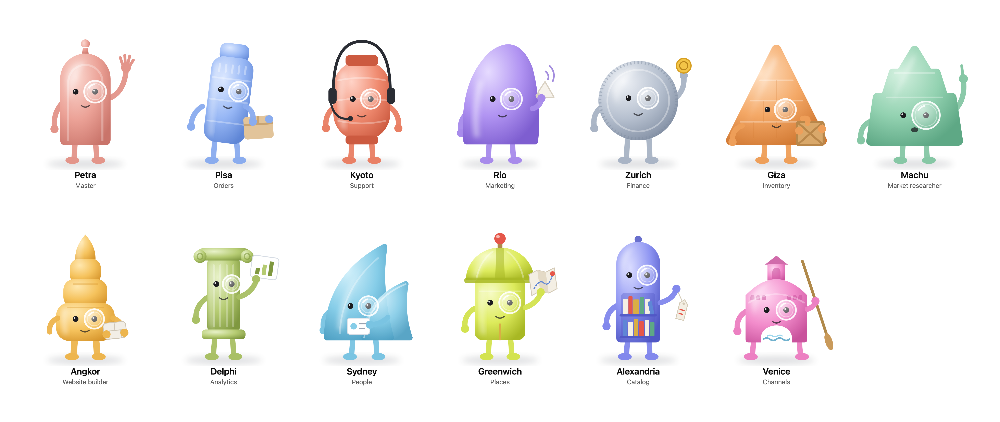

# tensquads design system

This repository is the reference for how tensquads looks, and the single source of the design. It holds the product screens, the approved page designs, Agent-UI and the squad mascots. It is served at <https://10squads.com/design> from this repository. The page is `index.html` here.



## Contents

| Path | What it holds |
|---|---|
| `index.html` | The design system page. It is the same page as <https://10squads.com/design>. |
| `logo/` | The tensquads logo, the round table: SVG for light and dark backgrounds, PNG at 512 px, the favicon and the Apple touch icon. Built from `scripts/logo.mjs`. |
| `mascots/svg/` | One SVG for each agent. The vector source. |
| `mascots/png/` | One PNG for each agent, 1200 × 1480 px, with a clear background. |
| `mascots/jpeg/` | One JPEG for each agent, 1200 × 1480 px, with a white background. |
| `mascots/cards/png/`, `mascots/cards/jpeg/` | One card for each agent, 1200 px wide: the mascot, name, role, palette, shape, reason, pose and colour. |
| `mascots/lineup.png`, `mascots/lineup.jpg` | All thirteen mascots in one image. |
| `mascots/mascots.json` | The name, role, palette, shape, reason and pose of each mascot, with its file paths. |
| `agent-ui/README.md` | Agent-UI, the visual language of the app: principles, content, colour, type, spacing, focus, themes, chat, icons and layout. |
| `agent-ui/data-display.md` | The rules for dashboards and charts. |
| `agent-ui/tokens.json` | Every token: colour in light and dark, type, spacing and sizing, radius, shadow and motion. The product screens use these and nothing else. |
| `agent-ui/tokens.css` | The same tokens as CSS custom properties. Built from `tokens.json`. |
| `agent-ui/components/` | The components: `bundle.css` (the `.aui-*` classes), `bundle.js` (the builders on `window.AgentUI`), `index.d.ts` (their types), and one folder per component with its guide (`README.md`) and its example (`preview.html`). |
| `agent-ui/previews/` | Each component example as a page that runs on its own. Built from `agent-ui/components/`. |
| `mascots/states/` | Each mascot in each Agent loop state, as SVG at 160 px. Built from `scripts/squadmates/`. |
| `screens/` | The product screens from the design canvas, file for file: one `.dc.html` per screen, `canvas.json` and `MANIFEST.json`. `support.js` is a small runtime that draws them in a browser. They started as a copy of the canvas. Since 11 November 2026 they are edited here, and `MANIFEST.json` holds the hash of each approved file. |
| `screens/inventory/` | The texts, styles, handlers and loops of each screen. Built by `scripts/design-inventory.mjs`. |
| `pages/` | The approved designs for pages outside the app: the homepage and the squadmates sidebar, with screenshots. |
| `scripts/` | The mascot drawings (`mascots.mjs`), the script that builds every generated file (`build.mjs`), `design-check.mjs` and `design-inventory.mjs`. |
| `scripts/squadmates/` | The app's avatar code: the mascots with the Agent loop states. The app package `@tensquads/squadmates` uses the same code. |
| `worker/`, `wrangler.jsonc` | The Cloudflare Worker that serves this repository at 10squads.com/design. |

## Agent-UI

Agent-UI is the visual language of the app. It came from the "Agent-UI" design system artifact on 2026-11-08, file for file. Load `agent-ui/tokens.css`, then `agent-ui/components/bundle.css`, then `agent-ui/components/bundle.js`. Put the `aui` class on the root of the screen. Set `data-theme="light"` or `data-theme="dark"` on `<html>`, or leave it off to follow the system setting.

The source face is not shipped. Inter replaces it at the same sizes. Code uses JetBrains Mono. The icons in `bundle.js` are original glyphs.

## Mascots

Each agent has one frosted toy. Each body takes its shape from the place the agent is named after. Every mascot wears one lens over its right eye. The lens is the squad's mark.

| Mascot | Role | Named after | Shape | Pose | Colour |
|---|---|---|---|---|---|
| Petra | Master | Petra, Jordan | Arched doorway with a round finial | Waves the team in | Rose sandstone |
| Pisa | Orders | Pisa, Italy | Leaning round tower with a bell top | Carries a parcel | Marble blue |
| Kyoto | Support | Kyoto, Japan | Paper lantern | Listens on a headset | Lantern vermilion |
| Rio | Marketing | Rio de Janeiro, Brazil | Tall rounded dome, like Sugarloaf Mountain | Calls out on a megaphone | Carnival violet |
| Zurich | Finance | Zurich, Switzerland | Thick coin with a milled edge | Holds up a gold coin | Vault silver |
| Giza | Inventory | Giza, Egypt | Pyramid of stacked blocks | Carries a crate | Desert orange |
| Machu | Market researcher | Machu Picchu, Peru | Mountain peak with two terraces | Points up at something it found | Jade |
| Angkor | Website builder | Angkor Wat, Cambodia | Tower of tiers with a lotus-bud tip | Carries a building block | Temple amber |
| Delphi | Analytics | Delphi, Greece | Fluted column with a scroll capital | Holds up a chart | Laurel olive |
| Sydney | People | Sydney, Australia | Two shell sails, like the Opera House | Shows a name badge | Harbour cyan |
| Greenwich | Places | Greenwich, London | Observatory dome with a shutter slit and a red time ball | Holds up a folded map | Meridian lime |
| Alexandria | Catalog | Alexandria, Egypt | Tall bookcase with an arched top and shelves of book spines | Holds up a price tag | Lapis indigo |
| Venice | Channels | Venice, Italy | Humped bridge with a centre arch, a portico and shop windows, like the Rialto | Holds a gondola oar | Murano magenta |

The exact colours are in `mascots/mascots.json`.

## Rules

- Use the files here. Do not redraw a mascot by hand.
- The logo is the round table, not a mascot. Use `logo/logo.svg` on light backgrounds and `logo/logo-dark.svg` on dark ones.
- Do not change the shape, the colour or the lens of a mascot. A change is made in `scripts/mascots.mjs`, and then every file is built again.
- Do not edit `agent-ui/tokens.css`, `agent-ui/previews/` or `index.html` by hand. Change the source, then build again.
- Show a mascot on a light surface. The PNG has a clear background. The JPEG has a white one.

## Build the files again

The build needs Node.js and Playwright with Chromium.

```sh
npm install
npx playwright install chromium
npm run build
```

## Checks

- `node scripts/design-check.mjs` proves that `screens/` matches the canvas version in `screens/MANIFEST.json`. It exits 1 on any difference.
- `node scripts/design-inventory.mjs` writes `screens/inventory/`. `node scripts/design-inventory.mjs --html <file>` lists a built page in the same form, so a build can be compared with its design.

## Deploy

10squads.com/design is the Worker `tensquads-design-system`. Its routes are `10squads.com/design` and `10squads.com/design/*`. They are more specific than the website route `10squads.com/*`, so these paths come here and every other path goes to the website.

1. Run `npm install`, then `npm run build`.
2. Run `CLOUDFLARE_API_TOKEN=<token> npx wrangler deploy`. The token needs Workers Scripts and Workers Routes on the 10squads.com zone.

`.assetsignore` keeps the scripts, the Worker and the package files off the site.
